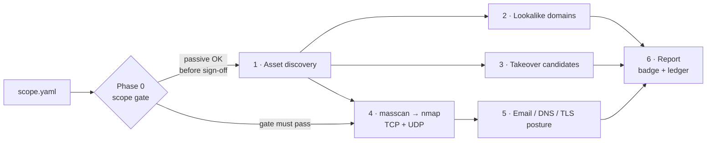

# External Attack Surface Recon

A scope-gated toolkit for mapping an organization's **internet-facing attack
surface** during an **authorized** penetration test. You give it the authorized
domains and IP ranges. It returns an auditable inventory: domains and
subdomains, exposed services, lookalike phishing domains, subdomain-takeover
candidates and email/DNS/TLS posture. Every result carries its source, and the
report states how much of the scope was actually covered.

It is also a [Claude Code skill](https://docs.claude.com/en/docs/claude-code/skills):
`SKILL.md` tells Claude how to run it. The scripts work fine on their own too.

> [!IMPORTANT]
> **Authorized use only.** Only scan assets you have written permission to
> test. This tool does reconnaissance and inventory. It runs **no**
> exploitation, vulnerability scripts, credential attacks or DoS-class
> traffic.

---

## Why it's built this way

Most recon tools find assets first and leave scope to the operator. This one
puts the authorization file in charge of every step that sends a packet.

- **Scope is enforced in code, not left to memory.** `scope_gate.py` checks
  `scope.yaml` before any step that touches a host:
  - the signed-off confirmation flag and the current engagement window
  - rate and timing ceilings
  - a scan-time estimate that has to fit in the window
- **A hostname under the client's domain isn't enough.** `shop.client.com`
  pointing at Shopify is the client's *name* on someone else's server. A
  hostname is scanned only if **every** IP it resolves to is inside an
  authorized CIDR.
- **Two layers of exclusion.** Targets come from the gate, and the same
  `out_of_scope` list is also passed to masscan *and* nmap as
  `--excludefile`.
- **Announced isn't authorized.** ASN prefixes are looked up and reported,
  never added to scope.
- **No made-up results.** A port masscan saw but nmap couldn't confirm is
  reported as `unconfirmed`, never `open`. Anything skipped is listed as an
  intelligence gap with the reason.
- **Coverage is computed, not claimed.** The report's `FULL` / `PARTIAL` /
  `MINIMAL` badge comes from a ledger of what was actually swept.

## Pipeline



| Phase | Script | Passive (no gate needed) | Gated 🔒 |
|---|---|---|---|
| 0 | `scope_gate.py` | — | validates scope, prints the scan plan |
| 1 | `01_passive_enum.py` | CT logs, subfinder, amass, Shodan, WHOIS, DNS, ASN prefixes (RIPEstat) | AXFR attempts, PTR sweep |
| 2 | `02_lookalike.py` | permutations (dnstwist or built-in) + DNS/CT/WHOIS enrichment | live HTTP probe (also needs `lookalike.live_probe: true`) |
| 3 | `03_takeover.py` | dangling-CNAME check against provider signatures | HTTP fingerprint of the provider's "unclaimed" page |
| 4 | `04_active_scan.py` | — | masscan breadth → nmap `-sV` confirmation, UDP pass, web probe |
| 5 | `05_posture.py` | SPF, DMARC, DKIM, MTA-STS, CAA, DNSSEC | TLS handshakes (protocol versions, certificate) |
| 6 | `06_report.py` | builds the report from local files only | — |

"Passive" means only data sources and ordinary recursive DNS. Anything that
connects directly to a host is gated. Hosts that belong to third parties, such
as lookalike domains, also need an explicit opt-in.

## Quick start

```bash
cd scripts
cp ../scope.yaml.example scope.yaml   # fill it in; set authorization.confirmed: true once signed off

python3 scope_gate.py --scope scope.yaml        # gate + scan plan + time estimate
./00_preflight.sh --scope scope.yaml            # tools, privileges, API keys, WSL networking

python3 01_passive_enum.py --scope scope.yaml --domain example.com   # validate small first
python3 01_passive_enum.py --scope scope.yaml                        # prints the run dir -> R
python3 02_lookalike.py    --scope scope.yaml --run-dir "$R"
python3 03_takeover.py     --scope scope.yaml --run-dir "$R"
python3 04_active_scan.py  --scope scope.yaml --run-dir "$R" --dry-run          # review the plan
python3 04_active_scan.py  --scope scope.yaml --run-dir "$R" --only 203.0.113.5 # one host
python3 04_active_scan.py  --scope scope.yaml --run-dir "$R"                    # full scan
python3 05_posture.py      --scope scope.yaml --run-dir "$R"
python3 06_report.py       --scope scope.yaml --run-dir "$R"                    # -> $R/report.md
```

Check one asset against scope at any time:

```bash
python3 scope_gate.py --scope scope.yaml --check 203.0.113.42
python3 scope_gate.py --scope scope.yaml --check www.example.com --ips 203.0.113.5,203.0.113.6
```

## Requirements

Built for **Kali Linux** (native or WSL2).

| | Tools |
|---|---|
| Required | `python3` + PyYAML, `dig`, `nmap`, `masscan` |
| Strongly recommended | `subfinder`, `amass`, `whois`, `openssl` |
| Recommended | `dnstwist`, [ProjectDiscovery `httpx`](https://github.com/projectdiscovery/httpx), `whatweb`, `subzy` |
| Optional | `SHODAN_API_KEY`, subfinder/amass provider keys, `gowitness` / `aquatone` |

- **Privileges.** masscan needs root or `cap_net_raw`
  (`sudo setcap cap_net_raw,cap_net_admin=eip $(command -v masscan)`). The
  UDP pass needs root. Without root, nmap falls back to a connect scan.
- **Missing tools.** Each missing tool disables only its own module.
  Built-in fallbacks cover lookalike generation, takeover signatures and HTTP
  probing. `00_preflight.sh` lists what will run fully and what will be
  degraded.
- **WSL2.** masscan behind WSL2's default NAT misses open ports. Set
  `networkingMode=mirrored` in `%UserProfile%\.wslconfig`, or use native Linux.
- **The wrong `httpx`.** The Python library's `httpx` command shares the name
  with ProjectDiscovery's tool. Preflight tells you which one you have.

## Configuring `scope.yaml`

Start from [`scope.yaml.example`](scope.yaml.example). The essentials:

```yaml
engagement:
  id: "ENG-2026-0001"
  window: {start: "2026-06-25T00:00:00Z", end: "2026-07-09T23:59:59Z"}   # always give an offset
  scanner_egress_ips: ["198.51.100.7"]
  emergency_contacts: ["Client SOC: soc@example.com / +1-555-0100"]
authorization: {confirmed: true, reference: "RoE-ExampleCorp-2026.pdf"}
in_scope:
  domains: ["example.com"]        # apex + subdomains; "*.example.com" = subdomains only
  cidrs:   ["203.0.113.0/24"]     # anything broader than /16 is rejected
  asns:    ["AS64500"]            # prefix lookup only — never authorizes IPs
out_of_scope: {domains: ["blog.example.com"], cidrs: ["203.0.113.200/29"], hosts: ["203.0.113.10"]}
rate: {masscan_max_rate: 1000, nmap_timing: T3, parallel_workers: 4}
scan: {ports: external-default, udp: true}
output: {dir: ./runs, retention_days: 90}
```

The gate **refuses** to run when:
- confirmation is missing
- the current time is outside the window, or the window is invalid
- masscan is set above 10,000 pkt/s, or nmap timing to `T5`, without a recorded
  `rate.high_rate_approval`
- the per-worker nmap rates add up to more than the overall ceiling
- the estimated scan won't finish before the window closes

## Output

Each run gets its own directory, `runs/<engagement>_<UTC timestamp>/`:

| File | What it is |
|---|---|
| `report.md` / `report.json` | the report: coverage badge, findings by severity, inventory, lookalikes, takeover candidates, port matrix, posture, intelligence gaps, coverage ledger, timeline |
| `assets.csv` / `assets.json` | consolidated inventory, with every source for each asset |
| `commands.log` | every external command and network action, with timestamps (audit trail) |
| `status.json` | each module marked ran, degraded, skipped, failed or aborted, with the reason |
| `scope_snapshot.yaml` | the exact authorization used. Later phases refuse to run if `scope.yaml` changes mid-run |
| `raw/`, `phase1/` … `phase5/` | raw tool output and per-phase results |

## Stopping a scan

Press **Ctrl-C**, or run `touch <run-dir>/STOP` from another terminal. Either
kills every running masscan and nmap process, records the abort and exits with
code 4. Phase 4 also stops itself when the engagement window ends. After
stopping, call the `emergency_contacts`. Full procedure:
[SKILL.md → Abort procedure](SKILL.md#abort-procedure).

## Handling results

Run output is a map of a client's attack surface:
- Keep it on an encrypted volume.
- Files are created owner-only, and the output directory gets a `.gitignore`.
- Never upload targets or results to public services.
- Delete runs by the deadline the report prints, which comes from
  `output.retention_days`.

This repository's `.gitignore` also excludes `scope.yaml` and `runs/`.

## Limitations

- **IPv6:** whole blocks aren't swept. Only IPv6 hosts found through AAAA
  records are scanned.
- **UDP:** covers a short list of ports. "open|filtered" (no reply) is never
  reported as open.
- **CDN detection:** uses published ranges for Cloudflare, Fastly and
  CloudFront. For Akamai, Azure, Imperva and others it relies on CNAME-name
  heuristics.
- **Not automated:** Censys, storage-bucket guessing, STARTTLS testing and
  screenshots are listed in the report as manual steps.
- **Testing:** the pipeline has been tested end to end against loopback and
  reserved test ranges. Validate it on one real in-scope host (`--dry-run`,
  then `--only`) before relying on it for an engagement.

## Repository layout

```
├── SKILL.md                 how Claude runs the skill (methodology + rules)
├── scope.yaml.example       authorization & scope template
├── scripts/
│   ├── 00_preflight.sh      environment, privilege and key checks
│   ├── scope_gate.py        Phase 0 gate, scope matcher, scan inputs
│   ├── common.py            run dir, audit log, abort handling, DNS/HTTP/CDN helpers
│   └── 01_… – 06_….py       the six phases
├── references/              scanning rationale, work-unit and intel-feed formats
└── signatures/              subdomain-takeover fingerprints
```
